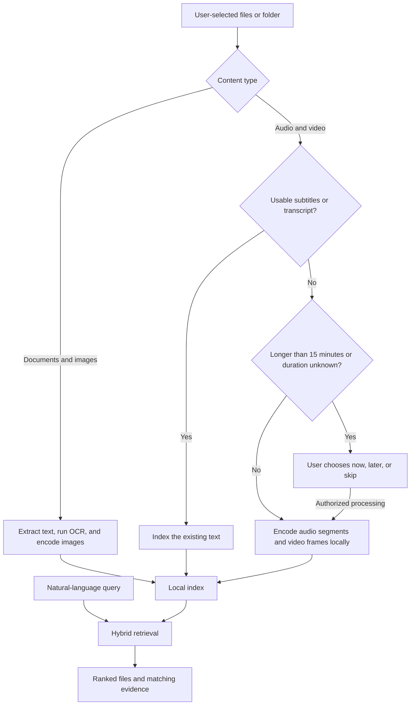

# ReFind

### Find what you remember.

**An AI-powered personal search engine that helps you rediscover files through the details you remember.**

Built by **Team BitByBit** for **AIBoomi Startup Weekend**.

**[GitHub Repository](https://github.com/joyelshajii/ReFind-2.0)** · [Product Demo](#product-demo) · [Features](#what-you-can-do) · [Run Locally](#run-locally)

---

## Overview

You remember what a document was about, a sentence from a recording, or the appearance of an image—but not its filename or folder. Searching through downloads, screenshots, presentations, and recordings becomes a time-consuming guessing game.

**ReFind lets you search using that memory.** It indexes the files you choose and combines semantic understanding with text, filenames, and metadata to retrieve relevant results. You can inspect supporting content and open the file you were looking for.

For example, you might search:

> “Find the architecture PDF about PostgreSQL and BLE.”
>
> “Find the screenshot showing a database diagram.”
>
> “Find the recording where we discussed the project deadline.”

ReFind is built for students, researchers, creators, and professionals whose useful information is spread across different file types. The prototype brings documents, images, audio, and video into one searchable local collection.

## Product Demo

**Demo link: Coming soon.**

<!-- Replace the placeholder above with your public video, hosted app, or presentation link before the AIBoomi submission. Example: [Watch the ReFind demo](YOUR_PUBLIC_DEMO_URL) -->

## The Idea

Human memory is associative: we remember a topic, a phrase, an image, or a moment. File systems organize information by names and locations. ReFind connects those two ways of finding information.

The prototype follows three principles:

- **Search by meaning.** Combine AI similarity with literal text and file information so a useful clue can lead back to the original file.
- **Keep the user in control.** Index explicitly selected uploads or a specified folder, with local extraction and embedding generation by default.
- **Reuse available information.** Check for subtitles, lyrics, and transcripts before doing expensive audio or video processing.

## What You Can Do

| Capability | What it provides |
| --- | --- |
| Natural-language search | Retrieve files using descriptions, remembered words, topics, and supported metadata clues. |
| Document search | Search extracted content from PDFs, Word documents, presentations, and text files. |
| Image search | Find images using visual similarity and locally extracted text through OCR. |
| Audio and video retrieval | Search supplied transcripts or directly indexed media; direct media matches include time ranges. |
| Transcript-first indexing | Reuse usable text subtitles, lyrics, or companion transcripts before processing the full recording. |
| Long-media scheduling | Choose whether to process expensive recordings now, later, or skip them. |
| Result context | Inspect relevant passages and matching evidence, with optional AI explanations. |
| Duplicate discovery | Identify exact and similar files and review cleanup options. |
| Quick Search | Use `Ctrl+K` / `Cmd+K` in the web app, or the optional Windows tray launcher with `Alt+Space`. |
| Index management | Browse indexed files, monitor progress, remove items, and clear stored uploads and index data. |

## How It Works



Search combines **semantic similarity, keywords, metadata, and filename matching**. If configured, Jina reranks candidate results. Gemini can generate explanations when you open a result's context.

Unchanged compatible files can reuse their index. Model provenance is stored with vectors so semantic search compares compatible embeddings.

### Audio and video behavior

1. **Check existing text first.** ReFind looks for embedded text subtitles, lyrics, and matching companion files such as `.srt`, `.vtt`, `.lrc`, `.txt`, `.ass`, `.ssa`, and text-based `.sub` files. Supported `.meta.json` transcript fields are also considered.
2. **Use the faster text path when possible.** Usable transcripts are indexed without full media decoding and inference. This path searches the transcript; it does not additionally index every visual scene. Titles, empty subtitles, and bitmap subtitles do not count as usable transcripts.
3. **Process media when text is unavailable.** Audio is encoded in overlapping segments. Video uses sequences of sampled frames and its audio track when present. Silent videos can be searched through visual content.
4. **Ask before expensive jobs.** Recordings longer than **15 minutes**, or with unknown duration, are deferred when no usable transcript exists. Choose **Continue now**, **Schedule later**, or **Skip for now**. Scheduled jobs survive backend restarts; ReFind must be running to process them. Overdue jobs resume when it runs again.

**Audio embeddings support semantic retrieval; they do not produce a verified written transcript.** Supplied transcripts support literal text matching. Video frame sampling can miss very brief events, and retrieval quality depends on the source content and model.

For companion files, use a matching name such as `meeting.mp4` with `meeting.srt` or `meeting.en.srt`. If you add a transcript later, explicitly select the recording again to update its index. Uploading a transcript alone does not reindex previous recordings.

## Technology Stack

| Layer | Technologies and role |
| --- | --- |
| Web interface | **Next.js 16, React 19, TypeScript, Tailwind CSS 4**, and **Lucide** icons. |
| Backend API | **Python, FastAPI, Pydantic**, and **Uvicorn** for indexing, search, and file operations. |
| Local AI | **Sentence Transformers** and **PyTorch** load the configured, pinned **EmbeddingGemma 2** model for the prototype's local embedding pipeline. |
| Document extraction | **PyMuPDF**, **python-docx**, and **python-pptx** extract document content. |
| Images and OCR | **Pillow**, **pillow-heif**, and **RapidOCR**, with a **Tesseract** fallback when installed. |
| Media decoding | **PyAV** provides local audio/video inspection and decoding through bundled FFmpeg libraries. |
| Storage and retrieval | **SQLAlchemy**, local **SQLite**, and **NumPy** for exact application-side vector scoring; optional PostgreSQL storage. |
| Optional cloud AI | **Jina** for reranking and **Google Gemini** for context explanations; separate legacy remote embedding options are configurable. |
| Windows integration | **C# / .NET 9 Windows Forms** for the tray launcher and global search shortcut. |

The default local model identifier and revision are defined in [`.env.example`](.env.example) and [`backend/app/core/config.py`](backend/app/core/config.py). The application loads that snapshot from the local Hugging Face cache.

## Privacy and File Control

- **Explicit indexing scope:** uploads index the files selected in that request. Folder indexing requires an absolute path and includes its subfolders. A blank path does not scan older uploads or a default folder.
- **Local processing by default:** text extraction, OCR, and embedding generation run locally with `LOCAL_FAST_MODE=true`.
- **Optional external requests:** configured Jina reranking sends the query and candidate text to Jina; Gemini explanations send relevant context to Gemini. Leave their API keys empty to use the local search path without these services. Legacy remote indexing requires explicitly disabling local-fast mode.
- **Local storage:** the default database is `backend/refind_local.db`; uploaded copies are stored under `backend/storage/uploads/` when using the provided backend startup instructions.
- **Remove / Clear Index:** these actions remove indexed data and ReFind's saved upload copies, including associated queue entries. Original files outside upload storage are preserved by these actions. Clear Index also removes saved uploads that failed indexing.
- **Duplicate cleanup:** its disk-deletion options can delete original files. Review the files selected for cleanup before confirming.

The prototype is intended for use on your own machine. Its local file APIs are not a hardened, authenticated public hosting service.

## Run Locally

### Prerequisites

- **Git**, **Python 3.12**, and **Node.js 22 with npm** match the current development environment.
- The configured **local model snapshot must already be available in your Hugging Face cache**. Model weights are not included in this repository, and the runtime intentionally does not download them automatically.
- A PyTorch installation compatible with your hardware. The code selects CUDA when available and otherwise uses the CPU; processing time depends on the hardware and content.
- **.NET 9 SDK** only if you want the optional Windows tray launcher.

### 1. Clone and configure

```bash
git clone https://github.com/joyelshajii/ReFind-2.0.git
cd ReFind-2.0
```

Copy `.env.example` to `.env`:

```powershell
# Windows PowerShell
Copy-Item .env.example .env
```

```bash
# macOS / Linux
cp .env.example .env
```

For the default local setup, keep:

```env
LOCAL_FAST_MODE=true
DATABASE_URL=
GEMINI_API_KEY=
JINA_API_KEY=
```

Keep the model ID and pinned revision from `.env.example`. Provision that exact snapshot in the local Hugging Face cache before indexing. A missing model produces a load error; it does not silently switch to a cloud provider. See the [local indexing guide](backend/docs/local_fast_indexing.md) for runtime details.

API keys are optional for local retrieval. Add them only for the optional services you intend to use. Keep `.env` out of Git.

### 2. Start the backend

**Windows PowerShell**, from the repository root:

```powershell
cd backend
python -m venv .venv
.\.venv\Scripts\python.exe -m pip install -r requirements.txt
.\start-local.ps1
```

On subsequent starts, run `start-local.ps1` from `backend`. It uses the project's virtual environment and checks that the media decoder is installed.

**macOS / Linux**, from the repository root:

```bash
cd backend
python3 -m venv .venv
.venv/bin/python -m pip install -r requirements.txt
.venv/bin/python -m uvicorn app.main:app --host 127.0.0.1 --port 8000
```

Run one backend process for the local model. Multiple workers load separate copies into memory.

- Backend: <http://127.0.0.1:8000>
- Interactive API documentation: <http://127.0.0.1:8000/docs>

### 3. Start the frontend

Open a second terminal at the repository root:

```bash
cd frontend
npm ci
npm run dev
```

On Windows, use `npm.cmd ci` and `npm.cmd run dev` if PowerShell blocks npm scripts.

Open **<http://localhost:3000>**. The frontend connects to `http://localhost:8000` by default. For a different local API address, set `NEXT_PUBLIC_API_URL` in `frontend/.env.local` before starting the frontend.

### 4. Index and search

1. Open **Indexing** and select files, or enter an absolute folder path.
2. Include matching subtitle or transcript files alongside recordings when available.
3. Wait for indexing to finish; review failures or pending media choices.
4. Open **Search**, describe what you remember, and inspect the results.

### Optional: Windows tray launcher

From the repository root, after backend setup:

```powershell
.\desktop\install-tray.ps1
```

The installer builds the launcher, starts it, and registers it to run at Windows sign-in. Press **Alt+Space** from another app to search, use **Up/Down** to select a result, **Enter** to open it, and **Escape** to dismiss the overlay. The launcher starts the local backend if needed.

To remove the launcher and its sign-in registration:

```powershell
.\desktop\uninstall-tray.ps1
```

## Prototype Scope

The implemented core covers local file indexing, hybrid search, image OCR, media retrieval, transcript reuse, deferred media jobs, duplicate discovery, and desktop quick search.

The account, membership, token-usage, and device-plan screens are **prototype UI**. They do not represent production authentication, billing, metered AI usage, or working cross-device synchronization. Cloud drive and email ingestion are not part of the current local-file workflow.

SQLite is the default storage path. PostgreSQL can be configured, but the current schema stores vectors as JSON and scores them in the application; enabling PostgreSQL does not create a native vector search index.

## Repository Guide

```text
ReFind-2.0/
├── frontend/           # Next.js interface, search, indexing, and settings
├── backend/
│   ├── app/
│   │   ├── api/        # Search, indexing, documents, and duplicate endpoints
│   │   ├── processors/ # Document, image, audio, and video processing
│   │   └── services/   # Embeddings, retrieval, media jobs, and file management
│   ├── docs/           # Technical notes and performance measurements
│   ├── tests/          # Backend test suites
│   └── start-local.ps1
├── desktop/            # Optional Windows tray application
├── .env.example        # Configuration template
└── README.md
```

### Further documentation

- [Local indexing and model behavior](backend/docs/local_fast_indexing.md)
- [Performance measurements and reproduction notes](backend/docs/performance.md)
- [Backend configuration](backend/app/core/config.py)

---

**Team BitByBit · AIBoomi Startup Weekend**

**ReFind — Find what you remember.**
